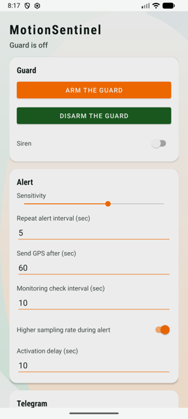
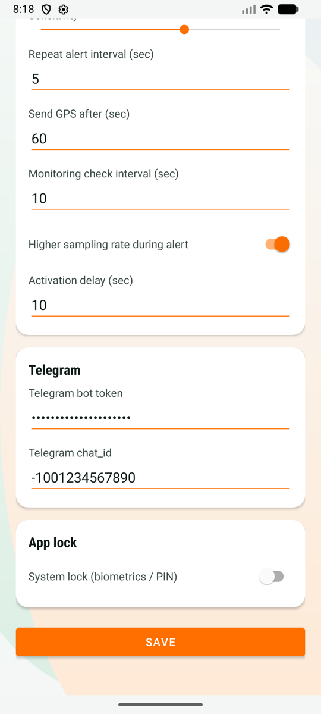

# MotionSentinel

Open-source Android anti-theft alarm for motorcycles, cars, bicycles, or anything else that should not move. When the phone senses motion, it sounds a siren (optional) and sends an alert, then a GPS location, to your Telegram chat.

Универсальная охранная сигнализация для мотоцикла, автомобиля, велосипеда и т. п.: при движении телефона — сирена (опционально) и уведомление с GPS-координатами в Telegram. Interface: English and Russian.

## Screenshots

 

## Features
- Motion detection with adjustable sensitivity and activation delay
- Optional siren, repeated alerts with configurable interval
- GPS location sent to Telegram after a configurable delay
- Foreground service with a low-frequency monitoring mode and a high-frequency mode during an alert
- App lock via system biometrics / PIN
- Token and chat id stored in `EncryptedSharedPreferences`; backups are disabled

## Setup
1. Create a bot with [@BotFather](https://t.me/BotFather) and copy its token.
2. Send any message to the bot, then get your `chat_id` (for example from `https://api.telegram.org/bot<TOKEN>/getUpdates`).
3. Install the APK from [Releases](../../releases), open the app, enter the token and chat id, grant location and notification permissions.
4. Activate the guard, leave the phone on the vehicle.

## Privacy
The app has no analytics or backend. The only network traffic is to `api.telegram.org`, using the bot you configure. Alerts and GPS coordinates go to your chat only.

## Build
Requires JDK 17 and the Android SDK.
```bash
./gradlew assembleDebug
```
Signed release builds run in CI on `v*` tags using secrets `SIGNING_KEYSTORE_BASE64`, `SIGNING_STORE_PASSWORD`, `SIGNING_KEY_ALIAS`, `SIGNING_KEY_PASSWORD`. Verify downloaded APKs against `SHA256SUMS`.

## Limitations
Battery optimisation on some vendors may kill background services; exclude the app from battery optimisation. It is a deterrent/notifier, not a certified security device.

## Contributing
See [CONTRIBUTING.md](CONTRIBUTING.md).

## License
[MIT](LICENSE)
